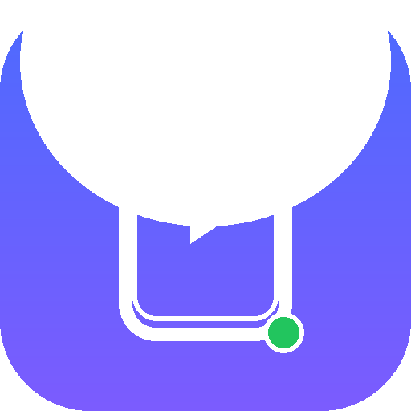
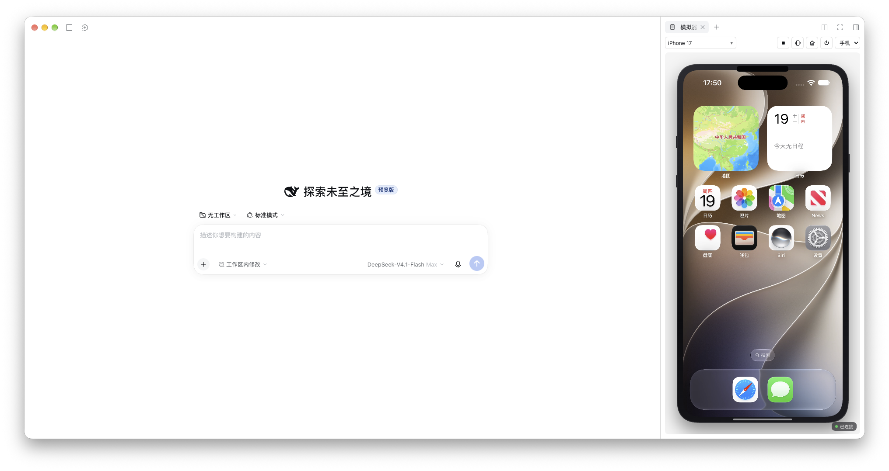
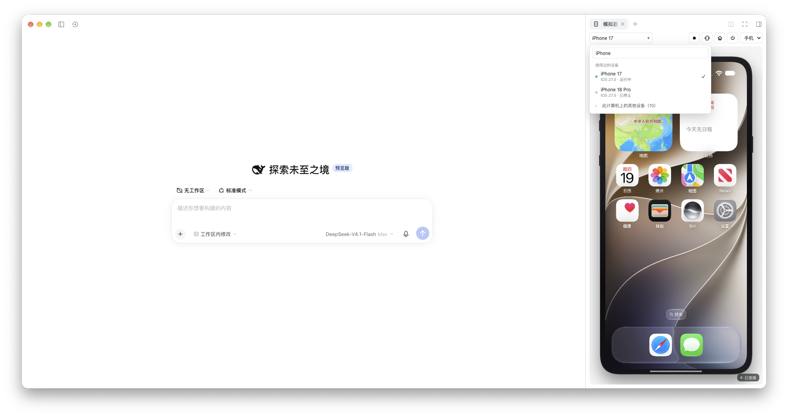

<p align="center">
  
</p>

<h1 align="center">dsh-sim</h1>

<p align="center">
  <b>iOS Simulator &amp; Android devices in a per-conversation sidebar tab for DeepSeek Harness.</b><br/>
  H.264 + WebCodecs streaming, tap-and-drag control, native phone frames.
</p>

<p align="center">
  <a href="README.md"></a>
  <a href="README.zh.md"></a>
  <a href="https://github.com/supperzl/dsh-sim/releases"></a>
  
  
  
</p>

<p align="center">
  
</p>

## Why dsh-sim

DeepSeek Harness has great agents but no eyes on a device. dsh-sim gives every conversation
its own simulator window: the agent taps and types through tools, you watch and steer from the
sidebar — on the same stream, scoped to that conversation.

- **Native tab, not an overlay** — registered through `dsh-better-sidebar`, so it appears in the
  **Start** page card grid and opens as a regular sidebar tab.
- **Per conversation** — tab instance and stream are keyed by the conversation id; sessions never
  share a device.
- **Low latency H.264** — iOS uses serve-sim's `/stream.avcc`; Android uses scrcpy-server 4.0.
  Both decode in the renderer with WebCodecs. No MJPEG, no per-frame PNG.
- **Real input, not screenshots** — taps, drags, text and keys go over the device control channel
  (serve-sim HID / scrcpy control socket), so there is no `adb input` process per tap.
- **Fits the sidebar** — phone frame / bezel / frameless shells, contain scaling, a compact
  toolbar that shrinks and drops controls on narrow widths.
- **Agent-ready** — ten `sim_*` tools bound to the active conversation.

## Screenshots

**The complete DSH window** — conversation on the left, the **Simulator** tab docked in the
right sidebar: live picture inside a phone frame, transport controls in the toolbar, floating
connection badge in the corner.


**Device picker** — search, recently used devices, collapsible "other devices", per-device
status and a check mark for the selected device.



## Requirements

| Item | Requirement |
| --- | --- |
| DeepSeek Harness | ≥ 0.2.2 (desktop or web) |
| dsh-better-sidebar | ≥ 0.32 — required, the tab is registered there |
| iOS Simulator | macOS + **full Xcode** (`xcrun simctl` and simulator runtimes) |
| Android | Android SDK `platform-tools` (`adb`); an AVD or a USB device |
| Node.js | ≥ 22 (the DSH host process) |

The first Android stream downloads **scrcpy-server 4.0** (~1 MB) into `~/.dsh/cache/dsh-sim`.
One GitHub request, offline afterwards.

## Install

### From a release (recommended)

Download `dsh-sim-<version>.tgz` from [Releases](https://github.com/supperzl/dsh-sim/releases)
and install that artifact into your profile — no clone or build needed:

```text
plugin_manager install_bundle /absolute/path/dsh-sim-0.1.5.tgz
```

The plugin manager registers the bundle, activates it, and its ten `sim_*` tools are available
immediately. The same artifact can be installed from the desktop Plugins page (*Add plugin* →
pick the `.tgz`) or with `dsh plugin --profile <name> add ./dsh-sim-0.1.5.tgz`.

### From source

```bash
git clone git@github.com:supperzl/dsh-sim.git ~/dsh-sim
cd ~/dsh-sim
npm install
```

Register the directory with a DSH profile:

- **Desktop** — Plugins page → *Add plugin* → choose the directory, or ask the agent to run
  `plugin_manager install_bundle /Users/<you>/dsh-sim`.
- **Web / TUI profile** — `dsh plugin --profile web add /Users/<you>/dsh-sim`.

Hard-refresh the GUI once (`Cmd+Shift+R`): the host picks the plugin up immediately, the browser
caches the client bundle for one load.

## Quick start

1. Right sidebar → **+** → **Start** page → click the **Simulator** card. A new tab reconnects
   the **last device you used** and starts it automatically (booting a simulator if needed).
2. Click the device button to switch, search or pick another device. Selecting it starts the stream:
   booted iOS simulators attach instantly, shutdown ones are booted first, Android AVDs are
   launched on demand.
3. Use the toolbar: play/stop, rotate, home, lock (iOS) / power (Android), frame style.
4. Tap and drag directly on the picture.

## The panel

- **Device picker** — grouped list with a search box: *Recently used* (last 12 devices, stored
  locally) and *Other devices on this computer (N)*. Every row shows the device name, its OS
  (`iOS 27.2`) or Android version/API (`Android 10 · API 29`), a status dot and the selected check.
- **Transport** — `▶ / ■`, rotate, home, lock (iOS) or power (Android).
- **Frame style** — `Phone frame`, `Bezel`, `Frameless`. The phone frame draws punch-hole, home
  indicator and side buttons, all scaled from the displayed width.
- **Scaling** — always `contain`: the whole device stays visible and follows the sidebar width.
  Drag the sidebar wider to zoom in.
- **Status badge** — a small floating capsule in the bottom-right corner (`Connected` /
  `Disconnected`); it never blocks clicks.
- **Narrow widths** — the picker shrinks first, then the frame selector hides, then the picker.

## Agent tools

All tools return plain JSON, are safe to call from the agent, and act on **the current
conversation's stream** (`exec.agent.session.id`). Coordinates are normalized `0..1` with the
origin at the top-left of the picture, matching what the panel displays.

| Tool | What it does | Arguments |
| --- | --- | --- |
| [`sim_devices`](#sim_devices) | List simulators, devices and AVDs | — |
| [`sim_start`](#sim_start) | Start a device and attach its stream | `device`, optional `platform` |
| [`sim_stop`](#sim_stop) | Stop this conversation's stream | — |
| [`sim_status`](#sim_status) | What this conversation is streaming | — |
| [`sim_screenshot`](#sim_screenshot) | Capture a PNG | — |
| [`sim_tap`](#sim_tap) | Tap at normalized coordinates | `x`, `y` |
| [`sim_swipe`](#sim_swipe) | Swipe between two points | `fromX`, `fromY`, `toX`, `toY`, optional `durationMs` |
| [`sim_text`](#sim_text) | Type ASCII text | `text` |
| [`sim_key`](#sim_key) | Press a navigation/hardware key | `name` |
| [`sim_rotate`](#sim_rotate) | Rotate the device | optional `orientation` |

### `sim_devices`

Lists everything this machine can stream. Use the returned ids with `sim_start`.

```jsonc
{
  "ios":     [{ "id": "A1B2…-UDID", "name": "iPhone 18 Pro", "state": "Booted", "runtime": "iOS.27.2" }],
  "android": [{ "id": "emulator-5554", "name": "Pixel 9", "state": "device", "kind": "emulator" }],
  "avds":    ["Medium_Phone_API_35"],
  "available": { "ios": true, "android": true }
}
```

`available` reports which toolchains exist; a `reasons` object explains what is missing
(no Xcode, no Android SDK) when a platform is unavailable.

### `sim_start`

| Argument | Type | Description |
| --- | --- | --- |
| `device` | string | iOS simulator UDID, Android serial (`emulator-5554`, USB serial) or AVD name |
| `platform` | `ios` \| `android` | Optional; inferred from the device id |

```jsonc
// start the running emulator
{ "device": "emulator-5554" }

// boot an AVD by name
{ "device": "Medium_Phone_API_35" }
```

Returns the session state: `{ running, platform, device, name, width?, height?, startedAt }`.
The stream replaces any previous stream in the same conversation.

### `sim_stop`

Stops the stream (and the underlying serve-sim helper / scrcpy server). The device itself stays
booted so the next start is instant.

### `sim_status`

Returns `{ running: false }` or the current device and size, plus optional client diagnostics
(`frames`, `errors`) reported by the panel.

### `sim_screenshot`

Captures a fresh PNG through `simctl io … screenshot` / `adb exec-out screencap` and returns
`{ path, width, height }`. The file lives in the system temp directory.

### `sim_tap`

```jsonc
{ "x": 0.5, "y": 0.85 }
```

Normalized `0..1`. iOS goes over the serve-sim HID WebSocket, Android over the scrcpy control
socket — no `adb input` process per tap.

### `sim_swipe`

```jsonc
{ "fromX": 0.5, "fromY": 0.8, "toX": 0.5, "toY": 0.2, "durationMs": 300 }
```

Sends a begin → 12 moves → end gesture; `durationMs` defaults to 300.

### `sim_text`

Types ASCII text. Android uses scrcpy's text injection; iOS maps characters to HID usages
(letters, digits, common punctuation, space, enter, tab).

### `sim_key`

`home`, `back`, `recents`, `power`, `volume_up`, `volume_down`, `enter`, `delete`, `menu`.
`back`/`recents`/`menu` are Android-only; on iOS `power` is treated as lock.

### `sim_rotate`

`portrait` | `landscape_left` | `landscape_right`. iOS switches to that orientation; Android
toggles the current rotation.

## Architecture

```
lib/
├── index.js          # host entry: tools, webserver routes, lifecycle
├── tools.js          # the ten sim_* tool definitions
├── client.js         # browser bundle: sidebar tab, device picker, WebCodecs player
└── host/
    ├── devices.js    # simctl / adb / emulator discovery
    ├── ios.js        # serve-sim lifecycle, AVCC endpoints, HID control protocol
    ├── android.js    # scrcpy-server startup, video/control sockets, control messages
    ├── manager.js    # sessionId-scoped streams, screenshots, idle reaping
    ├── resolve.js    # locate serve-sim / ws for a linked install
    └── routes.js     # /_dsh/dsh-sim/* HTTP routes, loopback + same-origin fences
```

The host keeps one entry per conversation id and exposes it over loopback-only HTTP:

| Route | Purpose |
| --- | --- |
| `GET /_dsh/dsh-sim/devices` | device inventory |
| `POST /_dsh/dsh-sim/status` | `{ sessionId }` → stream state |
| `POST /_dsh/dsh-sim/start` | `{ sessionId, platform, device }` |
| `POST /_dsh/dsh-sim/stop` | `{ sessionId }` |
| `POST /_dsh/dsh-sim/control` | `{ sessionId, event }` → input |
| `POST /_dsh/dsh-sim/screenshot` | `{ sessionId }` → PNG |
| `POST /_dsh/dsh-sim/diag` | panel-side decoder counters |
| `GET /_dsh/dsh-sim/stream?sessionId=` | streaming video bytes |

Read [docs/ARCHITECTURE.md](docs/ARCHITECTURE.md) for the protocol details (AVCC envelope
framing, scrcpy packet layout, socket timing, security fences).

## How the video works

- **iOS** — `serve-sim --detach` returns a handshake; the plugin rewrites `stream.mjpeg` to
  `stream.avcc` and relays the length-prefixed envelopes (avcC config, key frames, delta frames,
  JPEG seed) to the browser, which feeds them to a `VideoDecoder`.
- **Android** — a pinned scrcpy-server 4.0 is pushed once and started over `adb forward`. The
  video socket is accepted only once it stays open (the server must be ready), then the control
  socket connects; packets are normalized to AVCC and decoded the same way.

## Limitations

- iOS streaming is macOS + full Xcode only; Android needs an `adb`-visible device.
- One stream per conversation and one viewer panel per stream.
- The tools cover device control; build/run, OCR and UI-tree helpers are not included yet.
- Decoding requires WebCodecs H.264 (supported by the DSH desktop build).
- scrcpy requires a one-time download on first Android use.

## Development

```bash
npm run check                     # syntax-check every module + validate the bundle
python3 scripts/render-docs-images.py   # regenerate docs/images/icon.png (screenshots are real captures)
```

Toggle the plugin (`plugin_manager set_plugin`) to reload the host; hard-refresh the GUI for the
client bundle.

## License

MIT — see [LICENSE](LICENSE).

Third-party: [serve-sim](https://github.com/EvanBacon/serve-sim) (Apache-2.0),
[scrcpy](https://github.com/Genymobile/scrcpy) (Apache-2.0), [ws](https://github.com/websockets/ws) (MIT).
