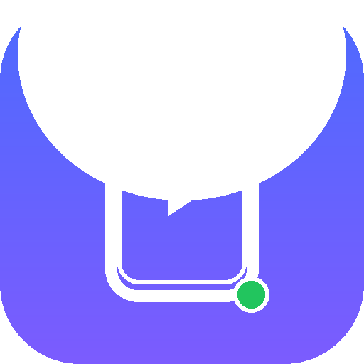
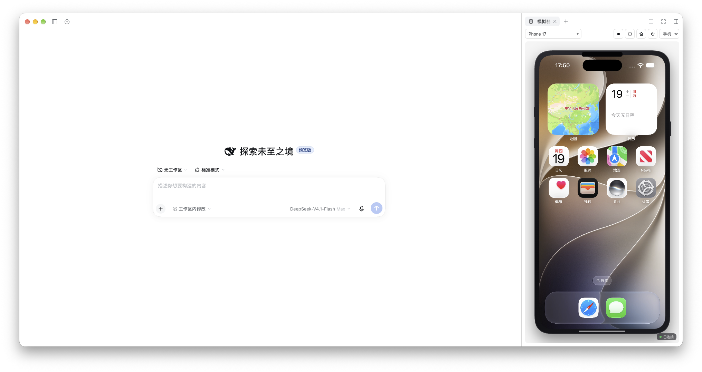
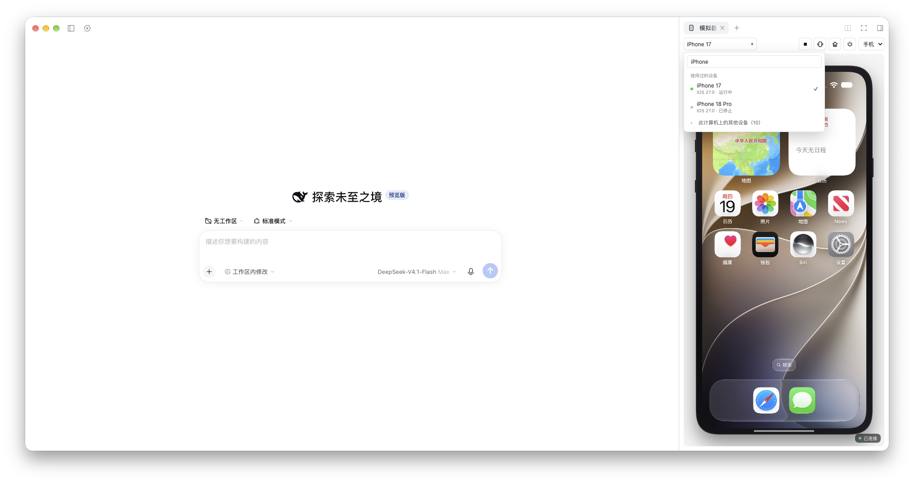

<p align="center">
  
</p>

<h1 align="center">dsh-sim</h1>

<p align="center">
  <b>DeepSeek Harness 的模拟器侧边栏：iOS 模拟器 / Android 设备，按会话隔离。</b><br/>
  H.264 + WebCodecs 实时推流，点按拖动直接操作，原生手机外框。
</p>

<p align="center">
  <a href="README.md"></a>
  <a href="README.zh.md"></a>
  <a href="https://github.com/supperzl/dsh-sim/releases"></a>
  
  
  
</p>

<p align="center">
  
</p>

## 为什么做 dsh-sim

DeepSeek Harness 的 agent 很强，但看不见设备。dsh-sim 给每个会话一台自己的模拟器窗口：
agent 用工具点按输入，你在侧边栏里看着并随时接管——同一路流，只属于当前会话。

- **原生 tab，不是浮层** —— 通过 `dsh-better-sidebar` 注册，出现在右侧栏「开始」页卡片网格里，
  点开就是一个普通侧边栏 tab。
- **按会话隔离** —— tab 实例和推流都以会话 id 为键，会话之间不共享设备。
- **低延迟 H.264** —— iOS 走 serve-sim 的 `/stream.avcc`，Android 走 scrcpy-server 4.0，
  浏览器用 WebCodecs 解码；不是 MJPEG，也不是逐帧 PNG。
- **真输入，不是截图回放** —— 点按、拖动、输入、按键都走设备控制通道
  （serve-sim HID / scrcpy control socket），不会每点一次起一个 `adb input` 进程。
- **适配侧边栏** —— 手机框 / 细边框 / 无框三种外壳、整体 contain 缩放、窄宽度下工具栏自动收缩。
- **为 agent 准备** —— 十个 `sim_*` 工具，绑定当前会话。

## 截图

**完整的 DSH 界面** —— 左侧是对话，右侧栏停靠「模拟器」tab：手机框里的实时画面、工具栏的
传输控制、右下角的连接状态胶囊。


**设备选择器** —— 搜索、使用过的设备、折叠的其他设备，每台设备的状态与选中标记。



## 环境要求

| 项目 | 要求 |
| --- | --- |
| DeepSeek Harness | ≥ 0.2.2（桌面版或 Web） |
| dsh-better-sidebar | ≥ 0.32 —— 必需，模拟器 tab 注册在它上面 |
| iOS 模拟器 | macOS + **完整版 Xcode**（`xcrun simctl` 与模拟器运行时） |
| Android | Android SDK `platform-tools`（`adb`）；AVD 或 USB 真机 |
| Node.js | ≥ 22（DSH 宿主进程） |

首次启动 Android 流时会把 **scrcpy-server 4.0**（约 1 MB）下载到 `~/.dsh/cache/dsh-sim`，
只需要一次 GitHub 访问，之后离线可用。

## 安装

### 用 Release 产物（推荐）

从 [Releases](https://github.com/supperzl/dsh-sim/releases) 下载 `dsh-sim-<version>.tgz`，
直接把这个产物装进 profile，不用克隆、不用构建：

```text
plugin_manager install_bundle /绝对路径/dsh-sim-0.1.5.tgz
```

插件管理器会注册 bundle、启用插件，十个 `sim_*` 工具立即可用。同一个产物也可以在桌面端
插件页「添加插件」里选 `.tgz`，或用 `dsh plugin --profile <name> add ./dsh-sim-0.1.5.tgz`。

### 从源码安装

```bash
git clone git@github.com:supperzl/dsh-sim.git ~/dsh-sim
cd ~/dsh-sim
npm install
```

把目录注册进 DSH profile：

- **桌面端** —— 插件页 →「添加插件」→ 选择目录；或让 agent 执行
  `plugin_manager install_bundle /Users/<you>/dsh-sim`。
- **Web / TUI profile** —— `dsh plugin --profile web add /Users/<you>/dsh-sim`。

安装后**硬刷新**一次 GUI（`Cmd+Shift+R`）：宿主端立即生效，浏览器会缓存一次前端包。

## 快速开始

1. 右侧栏 →「+」→「开始」页 → 点 **「模拟器」** 卡片。新 tab 会自动接上**上次使用的设备**
   并启动它（没启动的模拟器会自动 boot）。
2. 点左上角设备按钮可切换、搜索或选择别的设备。选中即启动：已启动的 iOS 模拟器直接接入，
   未启动的会自动 boot，Android AVD 按需启动。
3. 工具栏：播放/停止、旋转、主页、锁屏（iOS）/ 电源（Android）、外框样式。
4. 直接在画面上点按、拖动。

## 面板说明

- **设备选择器** —— 带搜索的分组列表：*使用过的设备*（本地最近 12 台）与
  *此计算机上的其他设备（N）*。每行显示设备名、系统（`iOS 27.2`）或 Android 版本/API
  （`Android 10 · API 29`）、运行状态点和选中勾。
- **传输控制** —— `▶ / ■`、旋转、主页、锁屏/电源。
- **外框** —— `手机框`、`边框`、`无框`。手机框会按显示宽度等比画出挖孔、Home 条和侧键。
- **缩放** —— 始终 contain：整台设备完整可见，跟随侧边栏宽度；拖宽侧栏即可放大。
- **状态胶囊** —— 画面右下角的小悬浮条（已连接 / 未连接），不挡点击。
- **窄宽度** —— 先收缩设备下拉，再隐藏外框选择，最后隐藏下拉。

## Agent 工具

所有工具返回纯 JSON，绑定**当前会话**的流（`exec.agent.session.id`）。坐标统一为
`0..1` 归一化值，原点在画面左上角，与面板显示一致。

| 工具 | 作用 | 参数 |
| --- | --- | --- |
| [`sim_devices`](#sim_devices) | 列出模拟器、设备、AVD | — |
| [`sim_start`](#sim_start) | 启动设备并接入当前会话 | `device`，可选 `platform` |
| [`sim_stop`](#sim_stop) | 停止当前会话的流 | — |
| [`sim_status`](#sim_status) | 当前会话推的是哪台设备 | — |
| [`sim_screenshot`](#sim_screenshot) | 截一张 PNG | — |
| [`sim_tap`](#sim_tap) | 按归一化坐标点按 | `x`、`y` |
| [`sim_swipe`](#sim_swipe) | 两点之间滑动 | `fromX`、`fromY`、`toX`、`toY`，可选 `durationMs` |
| [`sim_text`](#sim_text) | 输入 ASCII 文本 | `text` |
| [`sim_key`](#sim_key) | 按导航/硬件键 | `name` |
| [`sim_rotate`](#sim_rotate) | 旋转设备 | 可选 `orientation` |

### `sim_devices`

列出这台机器能推流的所有设备，返回的 `id` 直接给 `sim_start` 用。

```jsonc
{
  "ios":     [{ "id": "A1B2…-UDID", "name": "iPhone 18 Pro", "state": "Booted", "runtime": "iOS.27.2" }],
  "android": [{ "id": "emulator-5554", "name": "Pixel 9", "state": "device", "kind": "emulator" }],
  "avds":    ["Medium_Phone_API_35"],
  "available": { "ios": true, "android": true }
}
```

`available` 表示工具链是否存在；缺 Xcode 或 Android SDK 时会附带 `reasons` 说明。

### `sim_start`

| 参数 | 类型 | 说明 |
| --- | --- | --- |
| `device` | string | iOS udid、Android serial（`emulator-5554`、USB serial）或 AVD 名 |
| `platform` | `ios` \| `android` | 可选，按设备 id 自动推断 |

```jsonc
// 接入已在运行的模拟器
{ "device": "emulator-5554" }

// 按 AVD 名启动
{ "device": "Medium_Phone_API_35" }
```

返回 `{ running, platform, device, name, width?, height?, startedAt }`。
同一会话里再次 start 会替换旧流。

### `sim_stop`

停止当前会话的流（同时停掉 serve-sim 助手 / scrcpy 服务端）。设备本身保持启动，
下次 start 秒开。

### `sim_status`

返回 `{ running: false }`，或当前设备、尺寸，以及面板上报的客户端诊断
（`frames`、`errors`）。

### `sim_screenshot`

通过 `simctl io … screenshot` / `adb exec-out screencap` 抓一张新 PNG，返回
`{ path, width, height }`，文件在系统临时目录。

### `sim_tap`

```jsonc
{ "x": 0.5, "y": 0.85 }
```

归一化 `0..1`。iOS 走 serve-sim HID WebSocket，Android 走 scrcpy control socket。

### `sim_swipe`

```jsonc
{ "fromX": 0.5, "fromY": 0.8, "toX": 0.5, "toY": 0.2, "durationMs": 300 }
```

begin → 12 次 move → end；`durationMs` 默认 300。

### `sim_text`

输入 ASCII 文本。Android 用 scrcpy 的文本注入；iOS 把字符映射成 HID usage
（字母、数字、常用标点、空格、回车、Tab）。

### `sim_key`

`home`、`back`、`recents`、`power`、`volume_up`、`volume_down`、`enter`、`delete`、`menu`。
`back` / `recents` / `menu` 仅 Android；iOS 上 `power` 等同锁屏。

### `sim_rotate`

`portrait` | `landscape_left` | `landscape_right`。iOS 切到指定方向，Android 切换一次。

## 架构

```
lib/
├── index.js          # 宿主入口：工具注册、路由挂载、生命周期
├── tools.js          # 十个 sim_* 工具定义
├── client.js         # 浏览器 bundle：侧边栏 tab、设备选择器、WebCodecs 播放器
└── host/
    ├── devices.js    # simctl / adb / emulator 设备发现
    ├── ios.js        # serve-sim 生命周期、AVCC 端点、HID 控制协议
    ├── android.js    # scrcpy-server 启动、视频/控制 socket、控制消息
    ├── manager.js    # 按 sessionId 隔离的流、截图、空闲回收
    ├── resolve.js    # link 安装场景下解析 serve-sim / ws
    └── routes.js     # /_dsh/dsh-sim/* 路由与 loopback/同源围栏
```

宿主按会话 id 维护一份流，并通过仅回环的 HTTP 暴露：

| 路由 | 作用 |
| --- | --- |
| `GET /_dsh/dsh-sim/devices` | 设备清单 |
| `POST /_dsh/dsh-sim/status` | `{ sessionId }` → 流状态 |
| `POST /_dsh/dsh-sim/start` | `{ sessionId, platform, device }` |
| `POST /_dsh/dsh-sim/stop` | `{ sessionId }` |
| `POST /_dsh/dsh-sim/control` | `{ sessionId, event }` → 输入 |
| `POST /_dsh/dsh-sim/screenshot` | `{ sessionId }` → PNG |
| `POST /_dsh/dsh-sim/diag` | 面板解码计数 |
| `GET /_dsh/dsh-sim/stream?sessionId=` | 流式视频字节 |

协议细节（AVCC 信封、scrcpy 包结构、socket 时序、安全围栏）见
[docs/ARCHITECTURE.md](docs/ARCHITECTURE.md)。

## 视频是怎么通的

- **iOS** —— `serve-sim --detach` 返回握手，插件把 `stream.mjpeg` 改写为 `stream.avcc`，
  把长度前缀信封（avcC 配置、关键帧、差分帧、JPEG 种子）转给浏览器，喂给 `VideoDecoder`。
- **Android** —— 固定版本 scrcpy-server 4.0 推送一次并经 `adb forward` 启动；
  视频 socket 只有在「连上后不立刻断开」时才确认服务端就绪，随后立刻连 control socket；
  数据包归一化为 AVCC 后同样走 WebCodecs。

## 已知限制

- iOS 推流仅支持 macOS + 完整 Xcode；Android 需要 `adb` 能看到设备。
- 每个会话一路流、一个观看面板。
- 工具覆盖设备控制；构建运行、OCR、UI 树等能力暂未包含。
- 解码依赖 WebCodecs H.264（DSH 桌面版已支持）。
- Android 首次使用需要联网下载一次 scrcpy。

## 开发

```bash
npm run check                            # 语法检查所有模块 + 校验 bundle
python3 scripts/render-docs-images.py    # 重新生成 docs/images/icon.png（截图为真实截图）
```

用 `plugin_manager set_plugin` 禁用再启用即可热重载宿主；前端包改动需要硬刷新 GUI。

## 许可

MIT，见 [LICENSE](LICENSE)。

第三方：[serve-sim](https://github.com/EvanBacon/serve-sim)（Apache-2.0）、
[scrcpy](https://github.com/Genymobile/scrcpy)（Apache-2.0）、
[ws](https://github.com/websockets/ws)（MIT）。
